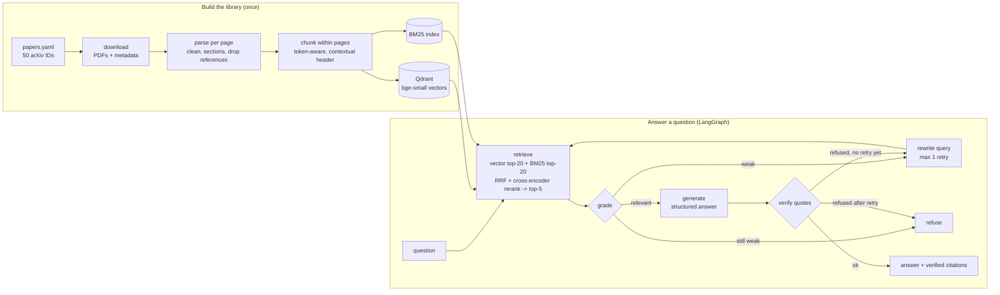

# PaperPilot

**A Corrective RAG research assistant over 50 influential AI/ML papers.** Ask a research question and get a short answer where every claim is backed by a quote that was checked against the source page. When the first search isn't good enough it rewrites the query and tries again, and when the library doesn't cover the question it says so instead of guessing.

<!-- demo GIF goes here:  -->

## What it does

- **Answers from the library only.** 50 hand-picked papers on transformers, RAG and retrieval, fine-tuning, vision and reinforcement learning, downloaded from arXiv.
- **Verified citations.** Every quote is fuzzy-matched against the text of the chunk it cites. Quotes that don't match are dropped, and if none survive the answer is refused.
- **Page-level links.** Each citation shows title, authors, year, page and the quote, with a link that opens the arXiv PDF at that page.
- **Self-correction.** A LangGraph loop grades the retrieved chunks, rewrites the query when retrieval or the answer step comes up short, and retries once.
- **Honest refusals.** Out-of-library questions get "Not enough evidence in the library" instead of an answer from the model's memory.
- **A path badge** on every answer: ✓ answered directly · ↻ answered after a corrected search · ! not enough evidence.

## Architecture



Grading is cheap by design: a top reranker score at or above 0.95 counts as relevant and at or below 0.05 as weak, with no LLM call. Only the uncertain middle zone asks a small Gemini model to grade the five chunks in one call.

## Evaluation

30 questions: 25 answerable, 5 on-topic but not in the library. The gold labels are page-level and were checked against the PDFs. A chunk or citation counts if it is on a gold page (±1).

**Retrieval (25 answerable questions)**

| Config | Hit@5 | MRR |
|---|---|---|
| vector (bge-small) | 92.0% | 0.717 |
| + BM25, fused with RRF | 92.0% | 0.753 |
| + cross-encoder reranker | **100.0%** | **0.850** |

**Answers (30 questions)**

| Config | Answered | Cited a correct page | Refusal accuracy | Citation validity | Faithful (LLM judge) | LLM calls / question |
|---|---|---|---|---|---|---|
| vector | 76% | 64% | 100% | 89% | 84% | 1.00 |
| + BM25 | 76% | 60% | 100% | 90% | 100% | 1.00 |
| + reranker | 96% | 96% | 100% | 84% | 83% | 1.00 |
| + Corrective RAG | **100%** | **96%** | **100%** | 84% | 88% | 1.63 |

- *Citation validity* is the share of the model's citations that passed verification. The rest were caught and dropped before the user saw them.
- *Faithful* is judged by the light Gemini model on about 20 answers per config, so read it as noisy.

**What the numbers say.** The reranker drives most of the gain (correctly cited answers 64% → 96%). Corrective RAG recovers the last unanswered question at the cost of 63% more LLM calls; on this set its paths were 24 direct, 1 corrected, 5 refused. All five out-of-library questions were refused in every config.

The error analysis is in [`eval/error_analysis.md`](eval/error_analysis.md). In short: of 7 misses in the first run, 5 were gold labels that were too strict (corrected under a written rule), one was an equation-heavy question that led to the "retry after a refused answer" change, and one still cites a survey instead of the original paper.

## Quickstart

Requirements: Python 3.12, [uv](https://docs.astral.sh/uv/), and a free Gemini API key from Google AI Studio (no billing needed).

```bash
git clone https://github.com/hidouri-iheb/rag-paperpilot.git
cd rag-paperpilot
uv sync
cp .env.example .env   # on Windows: Copy-Item .env.example .env
```

Fill in `.env` with your key and two model IDs from your AI Studio rate-limit page. This project used `gemini-3.5-flash-lite` for answers and `gemini-3.1-flash-lite` for grading and rewriting; two different models means two separate free quotas.

Build the library once. It downloads the 50 PDFs from arXiv, parses, chunks and indexes them, and takes about 20–30 minutes on a CPU:

```bash
uv run python -m paperpilot.ingest.build_library
```

Then start the API and, in a second terminal, the UI:

```bash
uv run uvicorn paperpilot.api.main:app
uv run streamlit run app/streamlit_app.py
```

Open http://localhost:8501. The API's interactive docs are at http://127.0.0.1:8000/docs.

From the terminal, without the UI:

```bash
uv run python -m paperpilot.ask "How does PPO clip the policy update?"
```

Tests and evaluation:

```bash
uv run pytest                          # no network, no API key needed
uv run python eval/run_eval.py         # retrieval ablation, no LLM calls
uv run python eval/run_answers.py      # answer ablation, uses Gemini (cached)
```

## Design decisions

- **Page-bounded chunks.** Chunks never cross a page, so every citation points to an exact page. Each chunk carries a header (`Title (Year) › Section › p.N`) that is embedded with it.
- **Token-aware chunking.** 214 chunks were over the embedding model's 512-token limit and would have been silently truncated. The chunker now splits them until they fit.
- **Hybrid search.** Dense vectors catch paraphrases; BM25 catches exact terms like `LoRA` or `GPT-3`. RRF fuses the two by rank, keyed by chunk ID.
- **Cross-encoder reranker.** It reads the question and each chunk together. Its logits go through a sigmoid so the Corrective RAG thresholds work on a fixed 0–1 scale.
- **Thresholds from data.** The cut-offs come from the score distributions of answerable vs unanswerable eval questions, which overlap. That overlap is why an LLM grader handles the middle zone.
- **Retry after a refused answer.** The first version only retried when the grade was weak. The error analysis showed a case where the grader accepted noisy chunks and the generator then refused, so a refused answer now also triggers one rewrite.
- **Verified citations.** Quotes are matched with `rapidfuzz` after normalising quotes, dashes, case and whitespace. The UI only ever shows citations that passed.
- **Free-tier friendly.** Every LLM call is cached on disk (keyed by model, prompt, schema and temperature) and retried with backoff on rate limits. Re-running the evaluation costs nothing.
- **Thin UI.** Streamlit only talks to the FastAPI backend, which owns the models and the Qdrant index. `/ask` is a plain `def`, so the blocking work runs in a thread pool instead of freezing the event loop.

## Tech stack

| Area | Tools |
|---|---|
| Data | `arxiv`, `pyyaml`, `httpx` |
| Parsing | `pymupdf4llm` (pinned below 2.0) |
| Retrieval | `sentence-transformers` (BAAI/bge-small-en-v1.5), `transformers` (BAAI/bge-reranker-base), `qdrant-client` (local mode), `rank-bm25` |
| Generation | `google-genai` (Gemini free tier), `pydantic`, `rapidfuzz`, `diskcache`, `tenacity` |
| Orchestration | `langgraph` |
| App | `fastapi`, `uvicorn`, `streamlit` |
| Quality | `pytest` (38 tests, all offline), `ruff`, `uv` with a lock file |

## Project layout

```
src/paperpilot/
  config.py            every setting, typed and validated
  models.py            Paper, Page, Chunk, Answer, VerifiedCitation, ...
  ingest/              download, parse, chunk, build_index, build_library
  retrieval/           embedder, vector_store, bm25, fusion, reranker, retriever
  generation/          llm (cache + retries), prompts, generator, verify
  graph/crag.py        the Corrective RAG graph
  api/main.py          FastAPI backend
  ask.py               terminal client
app/streamlit_app.py   UI
eval/                  questions, ablation scripts, results, error analysis
tests/                 unit and API tests
data/papers.yaml       the curated paper list (PDFs and indexes are not committed)
```

## Limitations

- **Small, optimistic eval set.** 30 questions written with the papers in mind, so they mostly use the papers' own vocabulary. One question is worth 4 points, and the grading thresholds were tuned on the same set.
- **Over-strict grounding.** If a question includes a detail the sources don't confirm ("Why did DeepMind argue…?"), the answer is refused instead of answering the supported part. Rephrasing without that detail works.
- **Research papers only.** Basic definitions ("what is linear regression?") are usually refused, because research papers assume them.
- **Equations and figures** don't survive PDF text extraction well. Some chunks contain figure-text noise, and a few papers may still include their reference list.
- **Secondary sources.** A survey can outrank the original paper (the HyDE question cites the RAG survey).
- **One request at a time.** The API serialises requests, because Qdrant local mode and the CPU reranker aren't built for parallel use. Fine for a demo, not for real traffic.
- **No conversation memory.** Every question is answered on its own.
- **Not containerised or CI-tested yet** (see the roadmap).

## Roadmap

- Docker image and compose file (API + UI), and GitHub Actions running lint and tests on every push.
- Answer the supported part of a question and say which part the sources don't cover.
- A larger eval set with casually phrased questions and a held-out split for threshold tuning.
- Live arXiv fetching for on-topic gaps, capped at three new papers per question.
- Tracing with Langfuse.
- A public demo. With the Gemini free tier this needs care: Google's terms only allow paid services for apps offered to users in the EEA, Switzerland and the UK.

## License and data

The code is MIT-licensed. The papers belong to their authors and are not redistributed: the repository contains only their arXiv IDs, and `build_library` downloads them from arXiv on your machine.